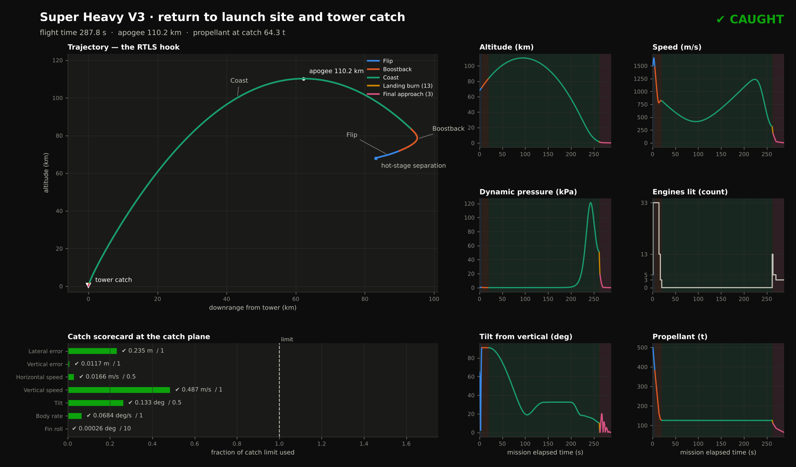
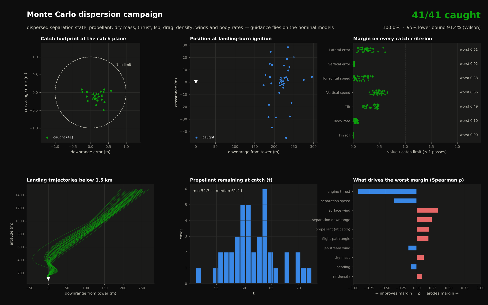

# quatsim — Super Heavy V3 return-to-launch-site and tower catch

A 6-DOF, quaternion-based simulation of a Super Heavy V3 booster from hot-stage
separation to the chopstick catch, with closed-loop guidance for every
phase, a Monte Carlo robustness campaign, publication-style figures and a
time-warped animation.



## Quick start

```bash
python -m venv .venv && source .venv/bin/activate
pip install -r requirements.txt
python -m pytest tests -q                  # 75 tests
python run_mission.py --figures            # nominal flight + 2 figures (~40 s)
(cd viz3d && npm install)                  # once: three.js + playwright-core
python run_mission.py --animate3d          # figs/catch3d.mp4, 3-D (~45 min on 3 cores, software GL)
python run_mission.py --montecarlo 100     # dispersed campaign (~25 min on 3-4 cores)
```

`main.ipynb` runs the same steps as a notebook. Outputs go to `figs/`:

| file | what it shows |
|---|---|
| `mission_overview.png` | trajectory hook, phase-coloured time histories, catch scorecard |
| `landing_detail.png` | landing burn: to-scale side view, top view, descent rate, horizontal speed, tilt vs guidance envelope, throttle |
| `monte_carlo.png` | footprint, ignition dispersion, margin on every criterion, landing trajectories, propellant, sensitivity |
| `monte_carlo.csv` | one row per case: every dispersion and every scored value |
| `catch3d.mp4` | **3-D render** of the whole flight: real-time boostback, 12× coast, 3× over the last 8 km, real-time landing burn and catch |
| `catch3d_viewer.html` | the same scene as a single interactive page: play, pause, scrub, free camera |

## Robustness result

**101 of 101 cases caught** (100 dispersed + nominal, seed 42): 95% lower
confidence bound on the catch rate 96.3% (Wilson). The same seed
caught 81/101 with a first, shorter version of the continuous-deceleration
final approach (item 11), 97/101 in an earlier guidance iteration, and the original guidance
caught 1/41 under the same dispersions.



| criterion | limit | median | 95th pct | worst |
|---|---|---|---|---|
| lateral error | 1 m | 0.15 m | 0.47 m | 0.62 m |
| horizontal speed | 0.5 m/s | 0.02 m/s | 0.18 m/s | 0.22 m/s |
| vertical speed | 1 m/s | 0.50 m/s | 0.62 m/s | 0.67 m/s |
| tilt | 0.5° | 0.17 ° | 0.24 ° | 0.25 ° |
| body rate | 1°/s | 0.04 °/s | 0.10 °/s | 0.32 °/s |
| vertical error | 1 m | 0.01 m | 0.02 m | 0.02 m |
| fin roll | 10° | 0.00 ° | 0.00 ° | 0.00 ° |

Propellant at catch: 59.2 t minimum, 66.8 t median. The tightest
margins are lateral error in the strongest jet-stream and surface winds.
With the roll locked from the coast onward, fin roll and body rate at
the catch stay small (fin roll ~0°, body rate ≤ 0.32°/s).

The catch criteria (all must pass, evaluated when the centre of mass reaches
the 105 m catch altitude): lateral error ≤ 1 m, vertical error ≤ 1 m,
horizontal speed ≤ 0.5 m/s, vertical speed ≤ 1 m/s, tilt ≤ 0.5°, body rate
≤ 1°/s, fin roll ≤ 10°.

Each case **plans** on the nominal models, **flies** a dispersed truth plant,
and **guides** on the nominal models plus what it can measure in flight
(see `quatsim/montecarlo.py`, 3-sigma values):

| dispersion | 3σ | dispersion | 3σ |
|---|---|---|---|
| separation altitude | 1.5 km | per-engine thrust | 3 % |
| separation downrange | 3 km | Isp | 2 % |
| separation crossrange | 500 m | dry mass | 1.5 % |
| separation speed | 30 m/s | drag coefficient | 15 % |
| flight-path angle | 1.5° | air density | 8 % |
| heading | 0.5° | surface wind | 0–12 m/s (uniform) |
| body rates | 0.5°/s/axis | jet-stream wind | 0–60 m/s (uniform), random direction/altitude/veer |
| propellant load | 15 t | wind forecast error | 30 % magnitude, 15° direction |

## What was wrong, and what replaced it

The starting point caught the booster on the nominal trajectory, but it was
a knife edge: shifting the separation point by 2 km missed the tower by
~1 km, and 5 m/s of crossrange velocity at separation missed by 330 m. Under
full dispersions it caught **1 of 41** cases. Each fix below came from a
diagnosed failure, in this order:

1. **The boostback predictor was discontinuous.** Engine-stage switches were
   evaluated only at 0.1 s step boundaries, so the predicted arrival jumped by
   ~4 km between neighbouring cutoff times. On top of that the root finder was
   a 7-step bisection (0.094 s ≈ 3 km resolution), and the nominal only hit
   because the aim point had been tuned around the chatter. The predictor
   now steps exactly onto stage boundaries and interpolates the altitude
   crossing. An Illinois-secant solver converges to 2 m in 4–6 shots and
   also solves the burn heading to null crossrange. It re-solves every 1.5 s
   during the burn (closed loop).
2. **Thrust dispersion dominated the arrival error** (ρ = −0.94). An
   IMU-style estimator measures thrust-to-mass during the flip and boostback,
   and tank gauging measures mass flow (an Isp error otherwise cut the burn
   early and arrived 750 m long). Both feed the predictor.
3. **No way to steer between boostback and landing.** Drag, density and wind
   errors moved the arrival point by hundreds of metres, and a 13-engine
   landing burn that cannot throttle below ~26 m/s² lasts only ~7 s and can
   divert only ~±250 m. The model gained a body normal-force (lift) term, and
   `quatsim/entry.py` adds grid-fin entry guidance: it predicts the arrival
   point, commands angle of attack within what the fins can hold against
   weathercocking, and uses a day-of-launch wind forecast plus an in-flight
   drag-scale estimator. Before the air is thick enough to steer, it holds
   the booster tail-first along the relative wind on RCS. Left alone it
   entered off-trim and swung ±25°, and with body lift those swings alone
   moved the arrival by ~1 km.
4. **The landing guidance was a stack of special cases**: crossrange was only
   ever damped, never steered to the target; the tilt taper was cancelled by
   a 20° floor; and drag was treated as always pointing up.
   `quatsim/landing.py` replaces it with one law in both engine phases:
   - vertical energy matching to a gate, then one constant-deceleration
     arc to the catch (see item 11);
   - a 3-D thrust-vector solve including estimated drag and lift, with
     vertical priority under tilt and throttle limits;
   - a velocity-field lateral law that is bounded everywhere and time-capped
     so the approach speed is gone before a final settle window.
5. **The roll-to-catch could snap at 50°/s.** The coast delivers the fins
   ~180° from the catch orientation, and re-deciding the roll direction every
   step with `atan2` chattered. The direction is now decided once, at
   handover, and flown on a smooth time profile.
6. **A stopped vehicle could hover above the catch plane.** A constant flare
   feed-forward held it 0.1 m up until the tanks ran dry. The feed-forward
   now scales with the actual descent rate.
7. **Tuned from the plots.** The landing-detail figure showed the first
   terminal law catching, but as a 3 s, 0–12° tilt limit cycle. Lower
   lateral gains turned it into one smooth lean-and-return.
8. **Steady wind at the catch.** The softer gains left a ~0.9 m steady offset
   in a 12 m/s surface wind (a velocity field needs an error to produce a
   force). A disturbance observer compares measured horizontal acceleration
   with what the *actual* thrust vector should produce, and cancels the
   difference. Comparing with the command instead let attitude lag bias a
   calm-air catch by 0.3 m.
9. **The coast attitude was a belly-flop and a swivel.** The old "reorient"
   segment never commanded anything: the booster drifted broadside (tilt
   ~95°) for 100 s after boostback, then the entry hold swung it ~80° at
   up to 2.6°/s to meet the airflow. The reorient is now a controlled RCS
   slew to engines-first along the velocity predicted at entry interface,
   held until the air thickens (peak rate 1.5°/s, then ~0 through the
   coast).
10. **The booster rolled 180° during the final approach.** The middle grid fin
    is the rudder and belongs on the downrange side (+x, away from the
    tower), but the reorient's default roll reference put it on the tower
    side. The reorient now sets the catch roll in vacuum, entry guidance holds
    it, and the landing burn locks it. Roll rate through the burn is ~0, and
    the terminal roll manoeuvre is only a fallback for a vehicle that arrives
    more than 35° off-roll.
11. **The final approach stopped high and crept into the arms.** The 13-engine
    brake cut the descent to 8 m/s at 250 m, and the 3-engine phase then
    descended at 8 m/s before a gentle flare: ~25 s of near-hover. The brake
    now hands over at ~24 m/s at 320 m, and the 3-engine phase wipes that off
    in one constant 1.35 m/s² deceleration (~17 s), so the speed bleeds away
    continuously all the way into the chopsticks. A first 12 s version
    (2 m/s² from 250 m) was smooth on the nominal but caught only 81/101:
    with a 45 m handover error in a strong jet stream the lateral law
    overshot the tower and the closing tilt envelope could not stop it. The
    longer arc fixed that, and the lateral field gained a fourth speed cap:
    the speed the closing envelope can still remove before the settle window.

## The 3-D animation

`viz3d/` renders the exported flight (`quatsim/export3d.py`) with Three.js
in headless Chromium, frame by frame, then encodes the frames with ffmpeg:

- **Earth:** a true-radius globe meshed as a polar grid refined around the
  pad. It is exact at the tower and curves to a real horizon from 100 km,
  with a procedural Gulf coastline, cumulus field and sun glint, and
  aerial-perspective haze integrated through an exponential atmosphere. The
  sky darkens to space with altitude.
- **Booster:** body stations from the CFD model (rocketcfd
  `vehicles/super_heavy.py`, photo-measured V3 dimensions). Bright stainless
  with weld seams. Four bevelled chines on the lower hull: a tall pair either
  side of the raceway and a short pair either side of the rudder fin. Also the
  raceway, a clamped conduit, the vent band, the black engine section with its
  panel row, and 33 Raptor 3 bells with powerheads, the outer ring overhanging
  the hull. The forward dome sits inside the open hot-staging truss. Three
  grid fins (`viz3d/tools/gridfin_mesh.py`) are generated from the CFD fin
  parameters: 3.5 m wide, 4.2 m reach, 0.5 m deep, diamond lattice, teeth on
  the engine-side face. The middle fin has the pair 180° apart at ±90° from
  it, and the pair rests on the chopsticks at the catch. Plumes expand into translucent vacuum
  plumes at altitude and tighten to shock-diamond plumes near the ground.
  The engines lit follow the simulation (5 → 33 → 13 → 3 → 13 → 5 → 3).
- **Tower:** modelled on photos of Tower 2. A truncated concrete pyramid
  base, steel cladding over the lower section, a heavy light-grey lattice
  with plan bracing, and an open frame box on top housing the drawworks. The
  chopsticks are deep trapezoidal box trusses with catch rails,
  shock-absorbing carts, bumpers and a hooked tip. They hang from a carriage
  that wraps the tower on drawworks cables, and close as the booster
  arrives, launch mount and tank farm. Tower 2 by default: the rig is
  rotated to its real heading, with the arms opening south-southwest and
  the tower north of the catch point. `--tower 1` gives the ocean-facing
  Tower 1. Your own `booster.glb` / `tower.glb` in `viz3d/assets/models/`
  replace the procedural models (see the README there).
- **Cameras:** one continuous move from separation to the approach: a chase
  orbit through flip and boostback that swings up behind the booster to
  look down on it and ahead toward the Earth and the tower through the coast.
  Then a cut to a long-lens tracking camera for the landing and catch. It
  stands about 700 m out at tower-top height, so the lean and the turn-in
  at the end of the burn are seen side-on rather than from below.
- **Replays:** after the catch hold, three replays:
  - SIDE VIEW: a camera square to the divert, from ignition to the catch,
    showing the lean, the divert and the return to vertical
  - FROM THE SEA: a long shot from sea level about 3.5 km offshore, with the
    tower small on the horizon and the booster flying in
  - AERIAL: a camera holding at 230 m that looks up at the booster during the
    burn, follows it down, and ends looking down on the catch

  The shots are listed in `quatsim/export3d.py` (`REPLAYS`), and the HUD
  labels each one.
- **HUD:** speed, altitude, engine diagram with a throttle gauge, an
  attitude sphere, and a mission timeline spaced by video time with a
  time-warp indicator.

Playback (`export3d.playback_schedule`): flip and boostback 1×, coast 12×,
the last 8 km before the landing burn 3×, landing burn and catch 1×, with
eased transitions and a 6 s hold on the caught booster.

## Guidance, phase by phase

| phase | engines | guidance | module |
|---|---|---|---|
| flip | 5 → 33 | smooth pure-pitch slew | `mission.py` |
| boostback | 33 → 13 → 3 | predictive cutoff + heading, re-solved in flight; thrust and mass-flow estimators | `mission.py`, `phases.py` |
| reorient + coast | 0 | RCS slew (~120 s, rate/accel feed-forward) to engines-first along the predicted entry-interface velocity, held through the vacuum coast, blended into the relative wind as q builds; grid-fin entry steering once q > 1.5 kPa; drag estimator | `mission.py`, `entry.py`, `phases.py` |
| landing brake | 13 → 5 | hard 13-engine brake until 5 engines can finish it (Flight 14 sequence), then energy-matched vertical, velocity-field lateral, 3-D thrust vector | `landing.py` |
| final approach | 3 | one constant-deceleration arc (24 → 0.5 m/s at 1.35 m/s²), velocity-field lateral + disturbance observer, closing tilt envelope, roll to catch | `landing.py` |

## Catch tower and landing-burn sequence

- **Tower 2 orientation (default).** Starbase Tower 2's arms open to the
  south-southwest (heading ~190°, measured from satellite imagery), with the
  tower ~30 m north of the catch point. A booster coming home from the east
  therefore approaches *across* the arms rather than straight into the mouth,
  as it would with Tower 1. `quatsim/tower.py` builds everything in the tower
  frame and rotates it: the arm-tracking envelope (3 m toward/away from the
  tower, 5 m across), the rudder-fin roll at the catch (the rudder must point
  away from the tower, so the booster holds that roll from the vacuum
  reorient onward), and a new `tower_clearance_m` check, which is the
  smallest gap between the hull and the tower or open arms along the whole
  path. `python run_mission.py --tower 1` (or `CATCHSIM_TOWER=1`) flies the
  ocean-facing Tower 1 instead.
- **Approach corridor hold.** The first Tower 2 Monte Carlo caught 38 of 41.
  The three misses met every catch criterion but clipped an arm by 1–3 m.
  They had 11–12 m/s of wind, and the 3-engine final approach was still
  closing 10–20 m of error across the arms when the hull reached arm height.
  The terminal guidance now slows the descent in the 30 m above the arms
  whenever the error across the arms exceeds 2 m. It comes down to a hover
  with the hull's lower end 8 m above the arms, never level with them, so a
  booster that arrives far off slides in above the arms rather than into
  them. Holds last 3–6 s in those cases, and all three are now
  caught with 2–2.5 m of hull clearance.
- **13 → 5 → 3 landing burn (Flight 14).** The brake ignites on 13 engines
  and drops to 5 once five engines can finish the energy-matched brake with
  20% throttle margin. Until then the 13 brake hard (85% of full thrust), so
  that point arrives. The 5 then hand over to 3 at the terminal gate. On the
  nominal flight that is 13 → 5 at ~1000 m and 5 → 3 at ~330 m.
  `LandingConfig(n_mid=0)` restores the old 13 → 3 burn.

## Working grid fins

`GridFinSet` (`quatsim/aero.py`) models V3's three grid fins, each with its
own deflection about its radial hinge axis.
- **Rudder fin (+z):** deflecting it gives yaw and roll.
- **Catch pair (±y):** gives pitch and roll.

Between them the three give independent pitch, yaw and roll. The
engines-off attitude controller allocates its torque to the three
deflections. Each fin is limited to ±20° and 40°/s, and the fins hold
neutral below 1 kPa of dynamic pressure, where they would only show an
allocator dividing by nearly zero. RCS supplies whatever the fins cannot
deliver.

The deflections are logged (`fin_deflection`), plotted by `--figures` in
`figs/grid_fins.png` (each fin through the entry, alongside dynamic pressure
and altitude), shown in a GRID FINS gauge on the HUD, and animated in the 3-D
viewer. (A FIN CAM shot riding on the booster is still in the viewer, as
shot 5; it is not in the default replay list.)

Control derivatives:
- **Default:** the old placeholder authority, per fin. The catch pair's pitch
  authority is exactly the old model's; yaw comes from the single rudder fin.
- **From the CFD:** `python run_mission.py --fin-cfd fin_control.json`, using
  the per-fin moment derivatives from rocketcfd's deflected-fin sweeps
  (`cases/fin_control_export.py --base db_d0 --rudder db_rudder10:10
  --catch90 db_catch10:10`).

## Flight 15 profile (V3, CFD aerodynamics)

`python run_mission.py --flight 15` flies the V3 booster as on Flight 15:
- **Separation:** at 60 km (59–61 km reported), with the flight-path angle
  fitted so the booster apogee comes out at 92.3 km (92.2 km flown).
- **Aerodynamics:** the rocketcfd tables (`data/aero_db_v3.json`), including
  each grid fin's authority from the database's per-fin lift slopes.
- **Aim point:** the boostback aims 550 m offshore of the tower (200 m in the
  default profile).

The landing burn ignites at ~2.1 km and ~446 m/s (Flight 15: ~3 km, on an
offshore divert), goes 13 → 5 at ~1.3 km and 5 → 3 at ~330 m, and the catch
leaves ~37 t of propellant. `--flight 13`, the default, is the original
calibration on the estimated aerodynamics.

What flying on the CFD aerodynamics took:
- **q·α limit:** the landing guidance keeps the thrust (and so the body)
  within 600 kPa·° ÷ dynamic pressure of the relative wind. Leaning 30° into a
  100 kPa airstream at a fast, high ignition tumbled the near-neutral CFD
  airframe; the estimates were too stable to show it.
- **13 → 5 on thrust alone:** the drop to 5 engines no longer counts aero
  drag as braking. At ignition that drag is large, but it falls away as the
  booster slows, and 5 engines then could not finish the brake.
- **Room to move while held:** while the corridor hold has the booster
  waiting above the arms, the lateral steering gets the lean and speed of a
  normal approach. Before, it crawled across at a few m/s until the
  propellant ran out.

What the database says, against CatchSim's estimates:

| | CFD | Estimate |
|---|---|---|
| Drag coefficient at zero incidence | 1.2–1.95 | ~2× higher (fin factor 2.0) |
| Normal-force slope | 4.6–6.5 /rad | 2.0 /rad |
| Engines-first stability | near-neutral (restoring −0.18…+0.14 at 8°) | stable |
| Pitch damping (`cm_q`) | 0.4–1.2 | 12 |
| Fin authority | 4–7× the placeholder, strongest at Mach 0.8–1.1 (no transonic dip) | placeholder |

## CFD aerodynamics

`python run_mission.py --aero-cfd aero_db.json` flies on rocketcfd's
aerodynamic tables (`cases/aero_database.py`) instead of the estimates in
`quatsim/aero.py`, for both truth and guidance and in the Monte Carlo. It
uses the drop-in `quatsim/aero_cfd.py`, and provides:
- the full force at the actual angle of attack and roll
- the full moment about the centre of mass, through `airframe_moment`, which
  replaces the guessed weathercocking term
- pitch damping, from the table's quasi-steady estimate

The tables stop at 20° of incidence. Beyond that (the landing burn leans the
booster up to ~30° off the wind), crossflow terms grow like sin α and the
axial force like cos α from the last computed column, instead of freezing.

As a check, a synthetic table built from CatchSim's own estimates
(`tests/test_aero_cfd.py`) reproduces the default mission: ignition at
1,402 m vs 1,399 m, and 63.5 t vs 64.0 t of propellant left.
`--fin-cfd fin_control.json` adds the CFD fin derivatives (see Working grid
fins).

## Modelling notes and honest limits

- Aerodynamic coefficients (drag, weathercocking `cm_alpha`, body `cn_alpha`,
  grid-fin effectiveness) are **estimates**, not CFD. The Monte Carlo
  disperses drag and density, but not the moment or lift slopes.
- The catch target is the booster's **centre of mass** at 105 m. The
  animation draws the arms at hardpoint height (~35 m higher), where they
  would close.
- The final-approach throttle floor of 34% (below Raptor's nominal 40%) is
  inherited from the original model: 3 engines at 40% cannot descend in this
  mass model.
- Navigation is perfect (guidance reads the true state). The estimators
  measure the true acceleration, i.e. an ideal IMU.
- Grid-fin allocation is idealised (torque, not individual fin angles). Fin
  roll control is not modelled; roll uses RCS during the coast and
  differential gimbal under power.

The history of the original model's development is kept in `SOLUTION.md`.
